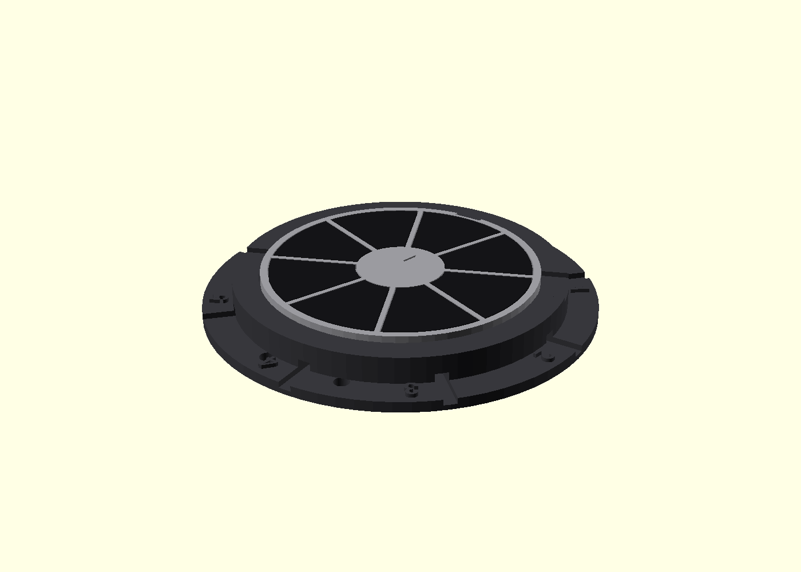

# Touch-test platter

A bench coupon for the first conductive-PLA measurement. Not a deck: there is
still no enclosure, no DevKit bay, no fader and no jacks. The numbers are the
first try from [`../PLATTER.md`](../PLATTER.md). Nothing here has been printed.

Eight conductive wedges drop into an insulating disc. The disc sits in a
numbered stand so the wires stay short and sector 0 stays at 12 o'clock.
Sector *i* is GPIO `4 + i`, clockwise from above.

## Print

0.2 mm layers. No supports. Do not let the slicer flip the parts: the STLs
are already in the print orientation.

| STL | Material | Qty | On the bed |
|---|---|---|---|
| `stl/stand.stl` | PLA or PETG | 1 | flat face down |
| `stl/carrier.stl` | PLA or PETG | 1 | flat face down, pockets up |
| `stl/wedges.stl` | conductive PLA | 1 plate of 8 | flat face down, bosses up |

`stl/wedge.stl` is a single wedge if you need a spare. Conductive PLA is
abrasive: hardened or stainless nozzle. Wedges are 100% infill. The carrier
and the stand are 3 perimeters, 15% infill. A brim on the wedges is worth it.

The wedge plate is 122 × 54 mm, the stand is 108 mm across, the carrier is
76 mm. Each fits a 180 mm bed. The stand and the carrier can share a plate.

If a wedge will not drop in, sand the vertical edges, not the play face.

## Wire it

1. Seat each wedge in a pocket. One small drop of CA on the pocket floor.
   Keep glue out of the gaps. The rib between pockets is the insulation
   (1.35 mm). Adjacent wedges must read open on a multimeter.
2. The boss hangs out of the bottom. An M2×3 pan head into the pilot can
   trap a stripped wire under the head. Conductive PLA cracks: if the boss
   splits, skip the screw and tape the bare wire to the boss. Do not drill
   through the play face.
3. Drop the carrier into the stand. The notch at 12 o'clock goes over the
   rib. That sector is **0**, and it goes to **GPIO4**. The raised digits
   sit beside each wire groove. Count clockwise: 1 is GPIO5, …, 7 is GPIO11.
4. Route each wire out its groove. Keep them under 10 cm, and away from the
   ADC, DAC and MIDI wiring. The two holes opposite sector 0 are for a zip tie.
5. Power the DevKit from the computer (USB), not from a bare battery. The
   touch reading depends on the ground path through the cable.

Then [`../../docs/BRINGUP.md`](../../docs/BRINGUP.md) step 1, and the tuning
recipe in [`../PLATTER.md`](../PLATTER.md). Write down the idle noise and the
finger rise. That is the whole point of this print.

## Files

- `platter-test.scad` — `part` selects `carrier`, `wedge`, `wedges`, `stand`.
  `N`, `gap`, `clearance`, `r_in` and `r_out` are at the top.
- `build.sh` — needs OpenSCAD on `PATH` (`OPENSCAD=...` overrides it).
  Writes `stl/` and checks the meshes with `check.py`.
- `preview/` — generated from the model.

A 6-sector reprint is `N = 6` and a rebuild. The firmware allows 3 to 8
(`touchSectors`).
